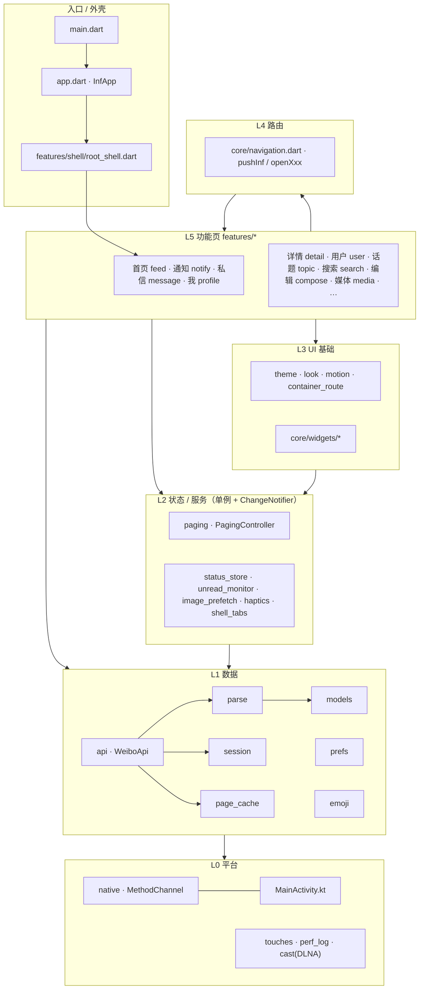

# INF-Flutter Code Map

这份文档讲代码结构：模块怎么分层、各文件管什么、依赖往哪个方向走、新功能应该放在哪里。

规模：`lib/` 共 69 个 Dart 文件，约 1.8 万行。支持 Android 和鸿蒙 NEXT，原生代码各一个文件：`MainActivity.kt` 和 `NativePlugin.ets`。

## 1. 分层总览



**依赖规则：只允许上层依赖下层。** 路由层是例外：

- `core/navigation.dart` 是唯一允许 import `features/*` 的 core 文件，它就是路由表。
- 任何 UI 层（包括 `core/widgets/*`）都可以调用 `navigation.dart` 来跳页面。

目前没有越层依赖；还剩一处有意保留的循环依赖（`api` ↔ `session`），见第 9 节。

## 2. 启动流程

```
main()
 ├─ Touches.ensureInitialized()           全局指针路由，统计手指数（长按只认单指）
 ├─ PerfLog.start()                       仅 --dart-define=PERF_LOG=true 时生效
 ├─ await Prefs.init() + PageCache.init() 偏好与首屏缓存全部读入内存
 ├─ EmojiStore.init()
 └─ runApp(InfApp)
      └─ 首帧后：Native.requestPeakRefreshRate()
                 → Session.init() → Session.refresh() → UnreadMonitor.start()
      MaterialApp(home: RootShell)
        RootShell：4 个 Tab 用 Stack + Offstage 常驻，1.2s 后预构建其余 Tab
```

`InfApp` 只在外观类偏好（风格、模糊、通透度、主题色、深浅色、字号）变化时重建 `MaterialApp`，其他偏好写入不会触发全局重建。

## 3. 目录与文件

### 3.1 入口

| 文件 | 职责 |
|---|---|
| `lib/main.dart` | 初始化单例，`runApp` |
| `lib/app.dart` | `InfApp`：主题、`InfLook`、本地化、系统栏样式、字号缩放 |

### 3.2 `lib/core/` —— 数据层（L1）

| 文件 | 主要符号 | 职责 |
|---|---|---|
| `models.dart` | `User` `Status` `Media` `Comment` `NotificationItem` `Conversation` `DirectMessage` `UserProfile` `FeedSource` `Draft` `ViewedStatus` `PageResult<T>` 等 | 纯数据模型和枚举，不依赖任何其他文件 |
| `parse.dart` | `parseWeiboResult` `toStatus` `toUser` `toComment` `parseXxx` `weiboHtmlToText` `parseWeiboTime` `relativeTime` `compactCount` `textOf/idOf/intOf` | 把微博 JSON 转成模型，外加时间、计数、HTML 文本工具。**所有 JSON 字段解析都放这里** |
| `api.dart` | `WeiboApi.instance` `ApiException` `LoginRequiredException` | 所有 m.weibo.cn 请求（Dio）。按注释分节：feeds / statuses / notifications and messages / relationships and people / comments / writes / plumbing。拦截器统一注入 UA、XSRF，Cookie 只发给 m.weibo.cn。另有几个免登录的公开接口走 `_getPublic`：热搜榜 `weibo.com/ajax/statuses/hot_band`、文娱/社会/科技/生活/体育/ACG 榜 `weibo.com/ajax/statuses/{entertainment,social,technology,life,sport,acg}`、推荐频道 `weibo.com/ajax/feed/allGroups`（type 1 分组）与频道流 `weibo.com/ajax/feed/hottimeline`（每次随机一批，`max_id` 只当页码）（这些要带 passport `genvisitor2` 换来的游客 SUB/SUBP，统一走 `_asVisitor`，失效时重取一次）、搜索提示 `weibo.com/ajax/side/search`、话题卡片与阅读趋势 `m.s.weibo.com/ajax_topic/detail|trend`（必须带对应 vtopic 页面作 Referer） |
| `session.dart` | `Session.instance` `SessionState` `WeiboConfig` | 登录态：从原生 CookieManager 读 m.weibo.cn 的 Cookie，判断 SUB 是否为访客，维护 `uid`、`st`、`xsrf`、`cacheScope` |
| `page_cache.dart` | `PageCache.instance` | 磁盘缓存若干列表的第一页原始 JSON（按账号隔离），启动时全部读入内存 |
| `prefs.dart` | `Prefs.instance` `AccentTheme` `VisualStyle` `HapticLevel` `ImagePreload` | SharedPreferences 封装：外观、触感档位、搜索历史、草稿、浏览记录、首页来源、推荐频道、热搜榜单顺序（`hotBoards`）、本机屏蔽名单（`blockedUsers`/`isBlocked`，信息流和 `PagedStatusList` 跳过，用户主页不跳过）、表情 |
| `emoji.dart` | `EmojiStore.instance` | 表情短码 → 图片 URL，从接口返回中学习并持久化 |
| `image_url.dart` | `sanitizeImageUrl` `secureUrl` `sinaimgSized` `weiboImageHeaders` | 图片 URL 规范化、http→https、sinaimg 尺寸替换、防盗链请求头。不含 Widget，状态层也可以用 |
| `links.dart` | `linkTargetOf` `LinkTarget` `linkKindOf` `linkKindLabel` `expandShortLink` `unwrapWeiboRedirect` | 链接归类：任意 http(s) / `sinaweibo://` 地址 → 微博、用户、话题、超话、t.cn 短链、网页、仅客户端可开；`linkKindOf` 按地址和 `timeline_card_small_*` 图标判断位置/超话/投票/抽奖/群聊等。纯逻辑，有测试 |

### 3.3 `lib/core/` —— 状态与服务（L2）

| 文件 | 主要符号 | 职责 |
|---|---|---|
| `paging.dart` | `PagingController<T>` | 通用游标分页：首屏 `seed`（缓存）、`refresh`（返回是否成功）、`loadMore`、去重、`fresh` 新增项标记、`onScroll` 触底加载 |
| `status_store.dart` | `StatusStore.instance` | 点赞与收藏状态的唯一来源（乐观更新 + 失败回滚），浏览记录写入，`feedRevision` |
| `unread_monitor.dart` | `UnreadMonitor.instance` | 未读数，每 2 分钟轮询一次，切到通知/私信 Tab 时强制刷新，跟随 `Session` 状态 |
| `image_prefetch.dart` | `ImagePrefetcher.instance` | 列表图片预取，按 `ImagePreload` 偏好和计费网络判断 |
| `haptics.dart` | `Haptic` 枚举 `HapticThreshold` | 触感反馈词汇表，所有震动都走这里 |
| `shell_tabs.dart` | `currentShellTab` `ShellTabAware` | 底栏当前 Tab；Tab 页用 mixin 的 `onTabShown` 代替生命周期 |
| `hot_search_store.dart` | `HotSearchStore.instance` | 榜单单例（按 `HotBoard` 分别缓存热搜/文娱/社会/科技/生活/体育/ACG）：首页「热搜」页、搜索页、热搜/话题详情页共用，2 分钟内不重复请求；`lookup()` 按词找回榜单条目（排名、热度、标签，先查热搜榜） |

### 3.4 `lib/core/` —— UI 基础（L3）

| 文件 | 主要符号 | 职责 |
|---|---|---|
| `theme.dart` | `infTheme` `accentColor` | 构造 `ThemeData`，包括 `PageTransitionsTheme`（预测性返回） |
| `chrome.dart` `chrome_classic.dart` `chrome_glass.dart` | `InfChrome` `ClassicChrome` `GlassChrome` | 两种风格分开实现的界面外壳：顶栏背景、页面底色、底部输入栏 `edgePanel`、悬浮控件 `floatingPanel`、输入面板 `typingSheet`、操作面板、小块底色 `fill`。页面只调 `InfChrome.of(context)`，不自己判断 `glass`；经典实现全部不透明，模糊和半透明只出现在 `GlassChrome` |
| `look.dart` | `InfLook`（ThemeExtension） `GlassSurface` `GlassBarBackground` `GlassSheet` `lookBarBackground` | 经典 / 毛玻璃风格。控件用 `InfLook.of(context)` 读取，不直接读 `Prefs`。玻璃分三档：静止的顶栏是浅乳白薄霜加细线，内容滑入下方后全霜；悬浮控件（底栏、热搜榜切换胶囊）全霜并用 `lifted` 投影；输入用的面板（评论框）不用玻璃 |
| `motion.dart` | `InfMotion` `showInfSheet` `showActionSheet` `afterFrame` | 所有时长和曲线常量；底部面板和操作菜单 |
| `container_route.dart` | `ContainerOrigin` `ContainerTransformRoute` | 卡片 → 详情、按钮 → 编辑页的容器展开转场，含返回手势驱动 |
| `layout.dart` | `WindowClass` `InfLayout` `contentGutter` `ContentColumn` `ContentBar` `ContentArea` `ShellLayout` | 平板适配：按窗口宽度分紧凑（< 600）/ 中等（600–840）/ 宽屏（≥ 840），叠加设置里的「设备布局」（自动 / 手机 / 平板）。非紧凑时外壳换成侧边栏，内容限宽 `kContentMaxWidth` 居中 |
| `pane.dart` | `DetailPane` `PaneSelected` | 宽屏双栏：首页、通知、私信左边列表、右边独立 Navigator（淡入淡出，空态「选择一条…」）。从列表打开替换右栏，从右栏里打开压栈；返回先退右栏，空了再交给外壳。`PaneSelected` 按 pane key 高亮左栏当前条目。窗口缩到中等时外壳不再构建它，右栏直接关闭 |
| `share.dart` | `statusLink` `shareText` 等 | 分享文案与链接 |

### 3.5 `lib/core/widgets/` —— 通用控件（L3）

| 文件 | 主要符号 | 用途 |
|---|---|---|
| `status_card.dart` | `StatusCard` `showStatusActions` | 信息流微博卡片（头部、正文、转发块、文章卡、操作栏；头部 IP 不被来源挤掉；正文里「…的微博视频」链接直接播放本条视频）；`showStatusActions` 是长按菜单，详情页右上角共用：长图、收藏（`api/statuses/createfav|destroyfav`）、复制、浏览器打开、本机屏蔽此人、投诉（`statusReportLink` 打开网页版举报页） |
| `share_sheet.dart` | `showStatusShare` | 详情页分享：最近私信联系人头像（点一下把微博链接发进私信）+ 系统分享、复制链接、长图 |
| `hot_board_bar.dart` | `HotBoardChips` `showHotBoardEditor` `shownBoard` | 热搜榜单切换条（长按拖动排序、+ 打开榜单管理：排序/移除/添加），首页热搜页与搜索页共用，顺序存 `Prefs.hotBoards` |
| `app_logo.dart` | `InfLogo` | 按启动图标路径画的两个渐变环，背景透明（长图左上角） |
| `paged_status_list.dart` | `PagedStatusList` | `PagingController<Status>` + `StatusCard` 的标准列表，带刷新、空态、错误、加载更多。`nested: true` 用于 `NestedScrollView` + 吸顶 Tab（配合 `SliverOverlapAbsorber`），`refreshable: false` 交给外层下拉刷新 |
| `hot_search_row.dart` | `HotSearchRow` `HotLabel` `rankColor` | 热搜榜单行（排名、新/热/沸标签、热度，`detailed` 时加分类与上榜时间） |
| `people_pager_list.dart` | `PeoplePagerList` | 分页用户列表 + 关注按钮 |
| `rich_text.dart` | `RichStatusText` `linkKindIcon` | 正文富文本：@提及、#话题#、链接、表情；链接用 `Status.links` 里微博给的文字和类型（地名、超话名、抽奖详情…） |
| `image_grid.dart` | `StatusImageGrid` `thumbnailUrl` | 九宫格，带 Hero tag |
| `smart_image.dart` | `SmartImage` `weiboImageProvider` `isImageInMemory` | 带防盗链 Referer 的网络图片 |
| `comment_sheet.dart` | `showCommentSheet` `CommentSheet` | 评论 / 回复底部面板，首页、详情、通知和 `PagedStatusList` 共用；两种风格下都是实心面板（`InfChrome.typingSheet`） |
| `mention_picker.dart` | `showMentionPicker` `EmojiKeyboard` `EmojiKeyboardSlot` `EmojiPanel` | @ 用户选择器和表情面板，评论面板、编辑页、私信共用 |
| `avatar.dart` / `user_row.dart` | `Avatar` `UserListRow` | 头像、用户行 |
| `refresh.dart` | `InfRefreshIndicator` | 下拉刷新（触发点触感、失败提示） |
| `transitions.dart` | `StateSwitcher` `RefreshingBar` `AppearIn` `RowListSkeleton` | 状态切换、后台刷新条、入场动画、骨架 |
| `common.dart` | `showMessage` `ErrorRetry` `EmptyHint` `CountBadge` `SectionHeader` `SkeletonBox` `StatusListSkeleton` `LoadingFooter` `KeepAlivePage` `formatBytes` | 杂项基础控件 |
| `paper.dart` | `PaperBackground` | 页面背景，`RootShell` 外层统一提供，内容由 `InfChrome.backdrop` 决定：经典是纸感渐变，毛玻璃是顶部两团极淡的主色/第三色光晕；页面直接用 `Scaffold` |
| `web_view.dart` | `InfWebView` | 统一 WebView（hybrid composition，规避 Impeller 白屏） |

### 3.6 `lib/core/` —— 路由（L4）与平台（L0）

| 文件 | 职责 |
|---|---|
| `navigation.dart` | `pushInf()` 统一 push：传了 `pane` 且处在双栏里 → 进右栏（`DetailPane.open`）；`overlay` → 透明浮层；有 `ContainerOrigin` → 容器展开；否则 `MaterialPageRoute`，都推在根 Navigator 上。以及所有 `openXxx(context, …)` 入口：能进右栏的（微博详情、楼中楼、用户主页、话题、聊天）显式传 `pane` key，其余（图片、视频、编辑、登录、网页、设置等）始终全屏 |
| `native.dart` | `Native`：MethodChannel `app.inf.flutter/native`，对应 `android/app/src/main/kotlin/app/inf/flutter/MainActivity.kt` 和鸿蒙的 `ohos/entry/src/main/ets/plugins/NativePlugin.ets`；`Native.isOhos` 判断鸿蒙 |
| `touches.dart` | 全局手指计数 |
| `perf_log.dart` | 帧耗时统计（编译开关） |
| `version.dart` | `appVersion`，设置页和「我的」显示用；须与 `pubspec.yaml`、`ohos/AppScope/app.json5` 一致，`test/version_test.dart` 检查 |
| `cast.dart` | 纯 Dart 的 SSDP 发现 + DLNA AVTransport 投屏 |

原生方法一览（`Native` ↔ `MainActivity`）：`getCookies` `setCookie` `clearCookies` `clearAuthCookies` `userAgent` `openUrl` `isMetered` `isPipAvailable` `enterPip` `saveImage` `saveVideo` `peakRefreshRate` `haptic`。新增原生能力时两边同时改，Dart 侧只通过 `Native` 调用。

鸿蒙端（`NativePlugin.ets`）实现同一组方法，另加 `share`（share_plus 没有鸿蒙实现，`share.dart` 在鸿蒙上走它）。差异：画中画、`setVolume` 返回 false，`peakRefreshRate` 返回 null；存图存视频走系统保存弹窗，每次需用户确认；实况照片只存静态图。

鸿蒙相关的其余部分：`ohos/` 是鸿蒙工程（`EntryAbility.ets` 注册 `NativePlugin` 并允许第三方 Cookie）；`pubspec.yaml` 里的 `*_ohos` 依赖是各插件的鸿蒙实现；`third_party/material_ui` 与 `third_party/cupertino_ui` 是覆盖 pub.dev 同名包的转发包，因为那两个包对 `TargetPlatform` 做穷举 switch，在多了 `ohos` 的鸿蒙版 Flutter 上编不过。主题里鸿蒙的页面转场按名字匹配 `TargetPlatform.ohos`，所以官方 Flutter 也能编译。

### 3.7 `lib/features/` —— 功能页（L5）

| 目录 | 入口 | 说明 | 打开方式 |
|---|---|---|---|
| `shell/` | `RootShell` | 底栏 4 Tab、fade-through、底栏随滚动收起、发微博按钮；宽窗口下换成左侧 `_SideRail`（Tab 区域用 GlobalKey 保留，切换布局不重建） | `InfApp.home` |
| `feed/` | `FeedPage` + `FeedController` | 首页顶栏三个等宽标签、推荐居中，三页可左右滑动，每页再点一次标题打开选择器：关注（全部关注流，切分组）、推荐（默认「热门」= 登录账号的 m.weibo.cn 102803 个性化流；「推荐」及其余频道 = weibo.com 游客推荐频道；`recommend_channels_sheet.dart` 选频道）、热搜（`HotBoardChips` 切榜单，标题处打开榜单管理）；底栏「首页」单击作用于当前页（回顶/刷新） | Tab 0 |
| `notify/` | `NotifyPage` | 通知四个子 Tab | Tab 1 |
| `message/` | `MessagePage` `ChatPage` `chat_link_sheet` | 私信列表、单聊/群聊、私信链接面板 | Tab 2 / `openChat` |
| `profile/` | `ProfilePage` | 「我」、菜单入口、退出 | Tab 3 |
| `detail/` | `StatusDetailPage` `CommentTile` `showCommentActions` `CommentFloorPage` | 微博详情、评论/转发切换、楼中楼（顶部显示主评论，取自 `hotFlowChild` 的 `rootComment`） | `openStatus` |
| `compose/` | `ComposePage` | 发博/转发、多图、草稿 | `openCompose` |
| `user/` | `UserPage` | 他人主页 + 时间线 | `openUser` |
| `topic/` | `HotTopicPage` `TopicPage` `SuperTopicsPage` | 热搜/话题详情：头部只留排名与标签、两行导语、主持人、一行热度摘要（点开「热点数据」面板看热度/阅读/讨论、24 小时阅读趋势、上榜记录、贡献者/媒体）、单行相关搜索、相关用户和「参与讨论/全站搜索」，下方吸顶「综合/实时/热门/视频」；`TopicPage` 用于赞过、container 流和话题内关键词搜索 | `openTopic` `openHotTopic` `openLiked` `openTopicFeed` `openSuperTopics` |
| `search/` | `SearchPage` | 输入时的搜索提示（联想词 + 用户）、热搜（与首页同款榜单切换条和详细行）、历史、微博/用户结果 | `openSearch` |
| `relations/` | `RelationsPage` | 关注/粉丝 | `openRelations` |
| `friends/` | `FriendsPage` | 好友 | `openFriends` |
| `history/` | `DraftsPage` `ViewedPage` | 草稿箱、浏览记录 | `openDrafts` `openViewed` |
| `media/` | `ImageViewerPage` `VideoPage` `cast_sheet` | 图片查看器（Hero、缩放、拖动关闭）、视频（PiP、下载、投屏） | `openImage` `openVideo` |
| `longimage/` | `LongImagePage` | 长图截图分享：底色随主题 `surface`、无外边距，左上角 `InfLogo`，底部保留「长图由 INF 生成」 | `openLongImage` |
| `login/` | `LoginPage` | WebView SSO 登录 | `openLogin` |
| `settings/` | `SettingsPage` | 外观、毛玻璃调节、触感、缓存 | `openSettings` |
| `web/` | `WebPage` `LinkFallbackPage` | 通用网页（http 升级 https、加载失败页、用浏览器打开；左上角返回 + 关闭，返回后 2 秒内又跳回刚离开的地址视为跳转页回弹，直接关闭；页内 `sinaweibo://` 的微博/用户/话题跳回 INF）；兜底页给只有微博客户端能开的链接 | `openLink`（所有正文链接、卡片的统一入口）`openWeb` `openLinkFallback` |

功能页之间现有的直接依赖（除 `RootShell` 引用 4 个 Tab 外）：

- `history/drafts_page` → `compose/compose_page.dart`（重发草稿）
- `media/video_page` → `media/cast_sheet.dart`（同模块）

被两个以上功能页用到的组件应放进 `core/widgets/`，不要让功能页之间互相 import。

## 4. 状态管理方式

项目**没有使用 Provider / Riverpod / Bloc**。如果以后要引入，需要整体迁移，不要和单例模式混用。约定如下：

- **全局状态 = 单例 + `ChangeNotifier`**：`Session` `Prefs` `StatusStore` `UnreadMonitor` `EmojiStore` 都是 `Xxx.instance`；`WeiboApi` `PageCache` `ImagePrefetcher` 也是单例，但不通知监听者。
- **页面状态 = `StatefulWidget` + `setState`**；页面逻辑较复杂时拆出页面级 `ChangeNotifier` 控制器（目前只有 `FeedController`）。
- **列表 = `PagingController<T>`**，由页面 `State` 创建和 `dispose`，用 `AnimatedBuilder` / `ListenableBuilder` 监听。
- **跨页面共享的可变实体状态放进 Store**：例如点赞状态只存在 `StatusStore`，列表渲染时用 `StatusStore.instance.apply(status)` 取当前值。
- **Tab 页**不依赖 `initState` 发请求，而是混入 `ShellTabAware`，在 `onTabShown(first:)` 里加载，因为 Tab 是预构建并常驻的。

## 5. 数据流（以一个列表为例）

```
Widget  ──创建──▶ PagingController<T>(fetch: (cursor) => WeiboApi.instance.xxx(cursor), id: …)
  ▲                    │ seed(WeiboApi.instance.cachedXxx())   ← PageCache 首屏
  │                    │ refresh() / loadMore()
  │                    ▼
  │             WeiboApi._get/_post ── Dio 拦截器(UA/Cookie/XSRF，取自 Session)
  │                    │
  │                    ▼  原始 JSON → parseWeiboResult → parseXxx/toXxx (parse.dart)
  │                    ▼
  └──notifyListeners── PageResult<T>(items, nextCursor)        (models.dart)
```

错误约定：未登录抛 `LoginRequiredException`（`Session.onLoginRequired()` 会切到未登录态），业务错误抛 `ApiException(message)`，UI 用 `showMessage` / `ErrorRetry` 展示。

## 6. 新功能放在哪里

| 要做的事 | 放在哪里 / 怎么做 |
|---|---|
| 新接口 | 在 `WeiboApi` 对应分节里加方法，只能用 `_get` / `_post` / `_postMultipart` / `_numberedPage`；JSON 解析写到 `parse.dart`；需要新模型就加到 `models.dart` |
| 列表首屏秒开 | 在 API 方法里 `cursor == null` 时 `PageCache.instance.write(session.uid, key, data)`，再提供 `cachedXxx()`，页面里 `pager.seed(...)` |
| 新页面 | `features/<模块>/<名字>_page.dart`；在 `navigation.dart` 里加 `openXxx(context, …)`，**其他地方只调 `openXxx`，不要直接 `Navigator.push`** |
| 新底栏 Tab 的子页面 | 混入 `ShellTabAware`，在 `onTabShown` 里加载 |
| 微博列表 | 直接用 `PagedStatusList(pager: …)`；用户列表用 `PeoplePagerList` |
| 页面顶栏 | `Scaffold(extendBodyBehindAppBar: InfLook.of(context).glass, appBar: AppBar(flexibleSpace: lookBarBackground(context), …))`，列表顶部留 `MediaQuery.paddingOf(context).top`，与现有页面保持一致 |
| 底部面板 / 长按菜单 | `showInfSheet` / `showActionSheet`（`motion.dart`），自动适配毛玻璃 |
| 动画时长、曲线 | 用 `InfMotion` 的常量，不要在页面里写魔法数字 |
| 卡片/按钮展开成新页面 | 点击时先 `ContainerOrigin.capture(context, …)`，紧接着调用 `openXxx` |
| 震动 | 只用 `Haptic.xxx.play()` / `HapticThreshold`，不要直接调 `HapticFeedback` |
| 新偏好项 | `Prefs` 里加字段和 `setXxx()`；如果影响外观，同步加进 `app.dart` 的 `_Appearance` |
| 风格相关的视觉 | 读 `InfLook.of(context)`，不要直接读 `Prefs.visualStyle` |
| 按屏幕宽度调整布局 | 只用 `WindowClass.of(context)`，不要自己比较 `MediaQuery.sizeOf(context).width`（它已经算上「设备布局」偏好）。滚动列表把 `contentGutter(context)` 加进列表自己的左右 padding（两侧空白仍可滑动）；不滚动的头部、Tab 条、底部输入栏包 `ContentColumn`，`AppBar.bottom` 用 `ContentBar` |
| Tab 页列表底部留白 | `ShellLayout.clearance(context, 底栏高度)`：有底栏时让出底栏，侧边栏布局下只留 24 |
| 网络图片 | `SmartImage` / `Avatar`（带防盗链头），不要直接用 `Image.network` |
| WebView | `InfWebView` |
| 跨页面同步的状态（如收藏、关注） | 仿照 `StatusStore` 建 Store：乐观更新、失败回滚、触感 |
| 原生能力 | `MainActivity.kt` 的 `when` 分支 + `NativePlugin.ets` 的 `switch` 分支 + `Native` 静态方法 |
| 测试 | `test/`：`widget_test.dart` 测解析，`paging_test.dart` 测分页，`layout_test.dart` 测宽度分档与内容留白。不依赖单例的纯逻辑都应该补测试 |

## 7. 持久化一览

| 存储 | 位置 | 内容 |
|---|---|---|
| SharedPreferences | `Prefs` | 外观、触感、首页来源、搜索历史、草稿、浏览记录（最多 60 条）、表情、上次 uid、欢迎页 |
| 文件 `app_support/page_cache/*.json` | `PageCache` | `feed` `profile` `notify-<kind>` `conversations-<strangers>` 的第一页原始 JSON，按 `Session.cacheScope` 隔离 |
| 图片缓存 | `flutter_cache_manager` | 由 `SmartImage` / `ImagePrefetcher` 使用，设置页可清理 |
| Cookie | Android `CookieManager` | 与登录 WebView 共享，经 `Native` 读写 |

## 8. 体量较大的文件（改动前先读）

| 文件 | 行数 | 备注 |
|---|---|---|
| `features/detail/status_detail_page.dart` | ~1260 | 详情 + 评论/转发两个列表 + 交叉淡化 |
| `core/parse.dart` | ~1210 | 所有解析 |
| `features/media/image_viewer_page.dart` | ~920 | 手势状态机 |
| `core/api.dart` | ~675 | 所有接口 |
| `features/compose/compose_page.dart` / `core/widgets/status_card.dart` | ~590 | |

## 9. 有意保留的结构

1. `core/api.dart` 和 `core/session.dart` 互相 import：`WeiboApi` 从 `Session` 取 Cookie，`Session.refresh()` 又调用 `WeiboApi.config()` 检查登录。Dart 允许循环 import，两者都是懒加载的单例，不会有初始化顺序问题。拆开需要引入接口或回调注入，复杂度大于收益，所以保留。
2. `StatusStore.toggleLike` 里直接调用 `Haptic`，状态层带了 UI 副作用。所有点赞入口都需要同样的手感，放在一处比每个调用方各写一遍更不容易漏。
